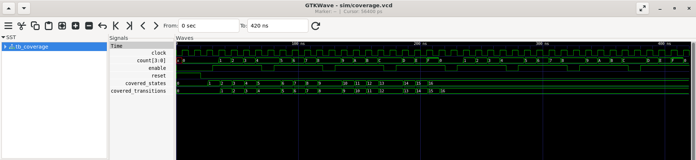

# Code Coverage and Functional Coverage Using SystemVerilog

## Overview

This project demonstrates functional coverage analysis of a 4-bit synchronous counter using SystemVerilog, Icarus Verilog, and GTKWave.

The testbench tracks the number of unique counter states visited and the number of distinct state transitions observed during simulation.

## Objectives

- Design and simulate a 4-bit synchronous counter.
- Verify reset and enable functionality.
- Measure state coverage.
- Measure distinct state-transition coverage.
- Analyze simulation waveforms using GTKWave.

## Tools Used

- SystemVerilog
- Icarus Verilog
- GTKWave
- Ubuntu on WSL
- Visual Studio Code

## Project Structure

```text
coverage_analysis/
├── design/
│   └── counter_4bit.sv
├── tb/
│   └── tb_coverage.sv
├── sim/
├── images/
│   └── waveform.png
├── README.md
└── .gitignore
```

## Design Description

The 4-bit synchronous counter operates on the positive edge of the clock.

- Reset clears the counter to zero.
- When enable is high, the counter increments.
- When enable is low, the counter retains its value.
- The counter wraps from hexadecimal F to 0.

## Coverage Methodology

### State Coverage

The testbench records which of the 16 possible counter states have been visited.

State coverage is calculated as:

State Coverage = (Unique States Visited / 16) × 100%

### Transition Coverage

The testbench records distinct transitions between consecutive sampled counter values. Each distinct transition contributes only once to the coverage total.

## Simulation Results

- Total possible states: 16
- Covered states: 16
- State coverage: 100%
- Distinct increment transitions: 16

The expected results above should be confirmed against the final simulation output.

## How to Run

Compile the design and testbench:

```bash
iverilog -g2012 -o sim/coverage_sim design/counter_4bit.sv tb/tb_coverage.sv
```

Run the simulation:

```bash
vvp sim/coverage_sim
```

Open the waveform:

```bash
gtkwave sim/coverage.vcd
```

## Waveform



## Conclusion

This experiment demonstrates manual state and transition coverage tracking for a 4-bit synchronous counter. Coverage counters increase when new states or distinct transitions are observed and stop increasing when no new ones are encountered.

This testbench implements manual functional coverage tracking; it does not measure automated RTL code coverage metrics such as statement, branch, or toggle coverage.
